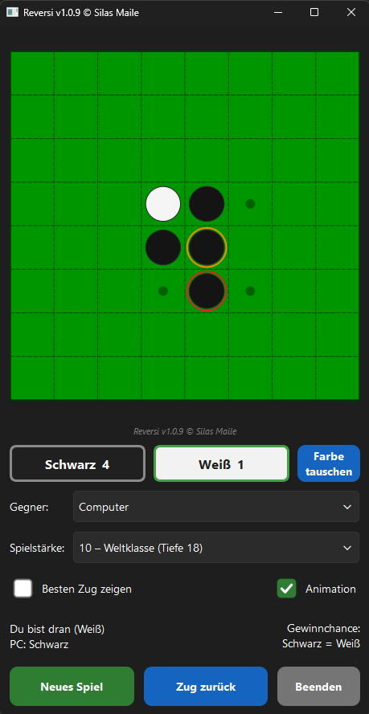

# Reversi

**Reversi (Othello) für Windows und Android – mit einer Spielstärke, die auch geübte Spieler schlägt.**

<p align="center">
  
</p>

Reversi ist ein Brettspiel für zwei: Wer einen Stein so setzt, dass gegnerische Steine zwischen ihm und einem eigenen
eingeschlossen sind, dreht diese um. Am Ende gewinnt, wer mehr Steine seiner Farbe auf dem Brett hat.

## Funktionen

- **10 Spielstärken** von *Anfänger* bis *Weltklasse* – die Stärke hängt an der Suchtiefe, nicht an der Rechenzeit,
  und ist damit auf jedem Gerät gleich
- **Zwei Spielmodi:** gegen den Computer oder zu zweit an einem Gerät
- **Bester Zug:** Zugvorschlag, der im Hintergrund immer tiefer rechnet, solange du nachdenkst
- **Gewinnchance** live angezeigt – sobald das Spiel durchgerechnet ist, steht der Sieger fest
- **Zug zurück**, **Farbe tauschen** mitten in der Partie, **Startstellung tauschen** und **Weiß beginnt**
- Der letzte PC-Zug ist rot, die dabei umgedrehten Steine orange markiert; optionale Dreh-Animation
- Für das Handy gemacht: große Bedienelemente, Hochformat, Zurück-Geste mit Nachfrage

## Die Engine

| Baustein | Umsetzung |
|---|---|
| Brett | Bitboards (zwei 64-Bit-Zahlen), Zuggenerator per Bit-Shifts |
| Suche | Negamax mit Alpha-Beta (PVS), iterative Vertiefung, lock-freie Transpositionstabelle |
| Selektive Suche | ProbCut – kalibriert an über 800 Stellungen, bei gleicher Rechenzeit ca. 61 % Siege gegen die Suche ohne |
| Endspiel | perfektes Spiel bis zum Ende (Stufe 10 ab 24 freien Feldern), Stabilitäts-Schnitt, „fastest first“-Sortierung |
| Bewertung | Mobilität, Frontsteine, Ecken, X-/C-Felder, stabile Steine, Steinzahl im Endspiel |
| Parallel | alle Prozessorkerne: Lazy SMP und Aufteilung der Wurzelzüge |

### Spielstärken

| Stufe | Tiefe | perfekt ab … freien Feldern |
|---|---|---|
| 1 Anfänger – 5 Mittel+ | 1 – 4 (mit absichtlichen Fehlern) | – bis 6 |
| 6 Fortgeschritten | 5 | 8 |
| 7 Stark | 7 | 10 |
| 8 Meister | 15 | 20 |
| 9 Großmeister | 16 | 21 |
| 10 Weltklasse | 18 + ProbCut | 24 |

## Bauen

Voraussetzungen: **Qt 6** (Widgets), **CMake ≥ 3.19**, ein C++20-Compiler.

**Desktop:** Projekt (`CMakeLists.txt`) in Qt Creator öffnen, Kit wählen, *Release* bauen.

**Android:** Qt für Android (arm64-v8a) und in Qt Creator unter *Einstellungen → Geräte → Android* JDK, SDK und NDK
einrichten. Für eine installierbare APK im Schritt *Build Android APK* einen Keystore wählen und *Paket signieren*
aktivieren. Mindestversion ist Android 9. Version und Android-Versionscode kommen aus `project(... VERSION x.y.z)`.

**Tests** (nur Desktop, ohne Qt):

```
engine_test   # Perft, Spielablauf, Zug zurück, Endspiel gegen Brute-Force, Stufen, ProbCut, Spielstärke
benchmark     # Rechenzeit + Prüfsumme (bleibt bei reinen Geschwindigkeits-Optimierungen gleich)
```

## Aufbau

```
include/  src/
  bitboard.h            Bitboards, Zuggenerator
  evaluation.*          Stellungsbewertung
  transpositiontable.h  Transpositionstabelle
  engine.*              Suche, ProbCut, Endspiel, Spielstärken
  game.*                Spielstand, Passen, Zug zurück
  boardwidget.*         Brett zeichnen (QPainter), Animation
  messageoverlay.*      Rückfragen und Spielende-Bildschirm
  checkboxstyle.*       gut sichtbare Ankreuzfelder
  reversigui.*          Hauptfenster
tests/                  engine_test, benchmark
```

## Changelog

- **1.0.9** – Eigene, gut sichtbare Checkboxen; neue Statuszeile mit Spielerfarben und Gewinnchance.
- **1.0.8** – ProbCut und doppelt so schnelles Endspiel: Stufe 10 rechnet Tiefe 18, perfekt ab 24 Feldern; Dialog „Neues Spiel“ mit Startoptionen; nummerierte Zugserien.
- **1.0.7** – Eigene Rückfragen statt Systemdialog, „Farbe tauschen“, Spielende-Bildschirm mit Glückwunsch.
- **1.0.6** – APK von 31 auf 14 MB verkleinert.
- **1.0.5** – Erste Version ohne Beta: „Zug zurück“, 10 neu abgestimmte Stufen, lesbarer Steinstand im dunklen Design.
- **1.0.4** – Ringe um den PC-Zug, Dreh-Animation, Gewinnchance-Anzeige, Zugvorschlag erst nach 1 s.
- **1.0.3** – Spielstärke-Stufen nach Suchtiefe, mitwachsender Zugvorschlag, Zwei-Spieler-Modus.
- **1.0.2** – Code komplett neu strukturiert, Version zentral aus CMake.
- **1.0** – Bitboard-Engine mit paralleler Suche, Android-Version, Handy-Oberfläche.

---

© Silas Maile
